# FIFO LAB — Interactive Page Replacement Simulator

> **Visualize Memory. Understand Every Fault.**  
> *An interactive Operating Systems Laboratory mini-project featuring real-time FIFO memory frame simulation, Belady's anomaly demonstration, live performance analytics, and AVA — an intelligent female AI voice assistant.*

---

## 1. Overview & Problem Statement

In modern virtual memory architectures, physical RAM is divided into fixed-size **page frames**, while program virtual address space is divided into **pages**. When a running process references a virtual page that is not currently resident in physical memory, the hardware Memory Management Unit (MMU) generates a **Page Fault** exception. The operating system kernel must then:
1. Locate the requested page on backing storage (swap space / disk).
2. Find an available free physical frame.
3. If all frames are occupied, choose a resident page to evict using a **Page Replacement Algorithm**.
4. Load the requested page into the frame and update the process page table.

**First-In, First-Out (FIFO)** is the most fundamental page replacement algorithm. It maintains a queue of resident pages and always evicts the page that has been in memory the longest (the oldest arrival). Despite its algorithmic simplicity, FIFO exhibits significant theoretical nuances—most notably **Belady's Anomaly**, where increasing the frame allocation paradoxically increases the total number of page faults.

**FIFO LAB** was built as a comprehensive, visual, and voice-assisted engineering laboratory workbench to help students, instructors, and systems engineers intuitively inspect memory snapshots, trace FIFO queues step-by-step, evaluate multi-process workloads, and understand why page faults occur.

---

## 2. Project Objectives

- **Visual Transparency**: Display historical memory frames in a textbook matrix format with sticky headers and responsive horizontal scrolling.
- **Queue Synchronization**: Animate the FIFO arrival queue horizontally from Oldest (Front) to Newest (Rear), ensuring strict synchronization with the memory table.
- **Accurate Algorithmic Logic**: Implement a decoupled pure FIFO simulation engine that strictly preserves queue order on page hits (preventing erroneous LRU behavior).
- **Belady's Anomaly Lab**: Provide an interactive side-by-side comparison illustrating why allocating more physical frames can yield worse page fault performance under FIFO.
- **Voice-Assisted Exploration**: Integrate **AVA (Adaptive Voice Assistant)**, utilizing the browser's Web Speech API for voice command recognition and female speech narration.
- **Multi-Process Workload Management**: Support independent processes ($P_1, P_2, P_3$) alongside global frame allocation strategies (*Equal*, *Proportional*, and *Custom*).
- **Academic Reporting**: Enable one-click export to CSV simulation logs, printable PDF lab reports with embedded charts, and high-resolution PNG snapshots for lab viva evaluation.

---

## 3. Key Features

| Category | Features |
| :--- | :--- |
| **Simulation Core** | Pure functional FIFO engine, step-by-step timeline scrubber, forward/backward stepping, auto-play with speed multiplier (0.25× to 3.0×), and keyboard shortcuts. |
| **Visual Elements** | Textbook frame table with sticky columns, animated cell transitions (fade-out eviction, slide-in load), and dynamic queue pointer badges. |
| **Voice Assistant** | **AVA** with Web Speech API recognition, dynamic female voice preference selection, animated audio visualizer waveform, step narration, and voice command parsing. |
| **Analytics** | Live KPI metric cards, Hit vs. Fault donut chart, Faults vs. Frame count (1–10) curve with automatic Belady's anomaly detection pill, and multi-process comparison matrix. |
| **Lab Tools** | Dedicated Belady's Anomaly Lab (comparing 3 vs. 4 frames side-by-side), random reference sequence generator (with optional deterministic LCG seed), and preset scenarios. |
| **Export & Persistence** | Full CSV trace export, PDF laboratory report generator (`html2canvas` + `jsPDF`), PNG table capture, and theme preference persistence via `localStorage`. |

---

## 4. Technology Stack & Dependencies

This project strictly adheres to vanilla web standards with zero package installations or compilation steps:

- **Markup**: Semantic HTML5 (accessible ARIA tags, descriptive element IDs, SVG icons).
- **Styling**: Vanilla CSS3 (Custom Properties / CSS Variables, Flexbox, CSS Grid, Glassmorphism, Light & Dark themes, `prefers-reduced-motion` compliance).
- **Logic**: Vanilla JavaScript (ES6+ modular architecture, decoupled pure simulation engine).
- **Typography**: [Inter](https://fonts.google.com/specimen/Inter) and [JetBrains Mono](https://fonts.google.com/specimen/JetBrains+Mono) via Google Fonts.
- **Data Visualization**: [Chart.js v4.4.7](https://cdn.jsdelivr.net/npm/chart.js) (via CDN).
- **Speech APIs**: Native HTML5 Web Speech API (`SpeechRecognition` / `webkitSpeechRecognition` & `SpeechSynthesis`).
- **Report Export**: [html2canvas v1.4.1](https://cdnjs.cloudflare.com/ajax/libs/html2canvas/1.4.1/html2canvas.min.js) and [jsPDF v2.5.1](https://cdnjs.cloudflare.com/ajax/libs/jspdf/2.5.1/jspdf.umd.min.js) (via CDN).

---

## 5. Folder Structure

```text
fifo-lab/
├── index.html        # Complete application layout, cards, modals, and templates
├── style.css         # Dribbble-quality styling, color tokens, themes, and animations
├── script.js         # Pure FIFO engine, UI renderers, AVA voice assistant, and charts
└── README.md         # Comprehensive project documentation and lab viva guide
```

---

## 6. How to Run the Application

### Option A: Direct Browser Launch
Simply double-click `index.html` or drag it into any modern web browser (Google Chrome, Microsoft Edge, Mozilla Firefox, or Safari).

### Option B: Local Development Server
For optimal compatibility with Web Speech recognition and PDF canvas rendering, run a local HTTP server:

```bash
# Python 3
python -m http.server 8080

# Or Node.js npx serve
npx serve .
```
Then navigate to `http://localhost:8080` in your browser.

---

## 7. FIFO Algorithm Deep Dive

### Algorithmic Principle
1. Physical memory is initialized with $F$ empty frames (`null`), and an empty FIFO queue $Q = []$.
2. For each incoming page reference $P$:
   - **Check Residency**: Scan frames to see if $P$ is present.
   - **Hit Case**: If $P$ is already in a frame, record a **Page Hit**. **Crucial Rule:** The FIFO queue $Q$ is *not* modified. (Moving $P$ to the back of the queue would erroneously transform FIFO into Least Recently Used / LRU).
   - **Fault Case**: If $P$ is absent, record a **Page Fault**:
     - *If an empty frame exists*: Place $P$ into the lowest available frame index, and push $P$ to the rear of $Q$.
     - *If all frames are full*: Dequeue the oldest page $P_{old}$ from the front of $Q$. Replace $P_{old}$ with $P$ in its physical frame slot, and push $P$ to the rear of $Q$.
3. Repeat until all page references are processed.

### Pseudocode
```python
def simulate_fifo(pages, frame_count):
    frames = [None] * frame_count
    queue = []
    hits = 0
    faults = 0

    for page in pages:
        if page in frames:
            hits += 1
            # Queue order remains unchanged on hit!
        else:
            faults += 1
            if None in frames:
                empty_idx = frames.index(None)
                frames[empty_idx] = page
                queue.append(page)
            else:
                oldest_page = queue.pop(0)
                replace_idx = frames.index(oldest_page)
                frames[replace_idx] = page
                queue.append(page)
                
    return hits, faults
```

### Time and Space Complexity
- **Time Complexity**:
  - Scanning $f$ frames per reference takes $\mathcal{O}(n \times f)$ time, where $n$ is reference string length and $f$ is frame count.
  - Using a Hash Set for membership check and a doubly-linked list for FIFO queue operations reduces time to $\mathcal{O}(1)$ amortized per reference ($\mathcal{O}(n)$ total).
- **Space Complexity**:
  - Requires $\mathcal{O}(f)$ auxiliary memory to store resident frame states and queue references.

---

## 8. Test Cases & Verification Results

### Test A: Classic Textbook Reference String
- **Reference String**: `7, 0, 1, 2, 0, 3, 0, 4, 2, 3, 0, 3, 2, 1, 2, 0, 1, 7, 0, 1`
- **Allocated Frames**: `3`
- **Expected Results**:
  - Total References: **20**
  - Page Faults: **15**
  - Page Hits: **5**
  - Hit Ratio: **25.0%**
  - Fault Ratio: **75.0%**
- **Status**: Verified by pure engine test suite.

### Test B: Belady's Anomaly Demonstration
- **Reference String**: `1, 2, 3, 4, 1, 2, 5, 1, 2, 3, 4, 5`
- **Allocation 1 (3 Frames)**:
  - Page Faults: **9**
  - Page Hits: **3**
  - Hit Ratio: **25.0%**
- **Allocation 2 (4 Frames)**:
  - Page Faults: **10** (Higher faults with more memory!)
  - Page Hits: **2**
  - Hit Ratio: **16.7%**
- **Observation**: Demonstrates Belady's Anomaly where allocating 4 frames causes $+1$ extra page fault compared to 3 frames.
- **Status**: Verified by pure engine test suite.

---

## 9. Voice Assistant (AVA) Architecture

**AVA (Adaptive Voice Assistant)** is engineered as a voice-driven interface to enhance laboratory accessibility and interaction:

```mermaid
flowchart LR
    A[User Microphone] -->|Speech Input| B[Web SpeechRecognition]
    B -->|Transcript Text| C[Voice Command Parser]
    C -->|Simulation Action| D[FIFO Engine & UI Controllers]
    D -->|Step Status / Explanation| E[Speech Queue Manager]
    E -->|Filtered English Female Voice| F[Web SpeechSynthesis]
    F -->|Spoken Response| G[User Audio Output]
```



### Supported Voice Commands:
- **Simulation Control**: `"Start simulation"`, `"Next step"`, `"Step back"`, `"Play simulation"`, `"Pause simulation"`, `"Reset"`.
- **Memory Configuration**: `"Set frames to 4"`, `"Select Process P2"`, `"Load Belady anomaly example"`, `"Load classic example"`.
- **Query & Analytics**: `"Tell me the page faults"`, `"Tell me the hit ratio"`, `"Explain current step"`, `"Explain FIFO"`.
- **Navigation & Export**: `"Open simulator"`, `"Show analytics"`, `"Export CSV"`.

*Fallback Note: If microphone permissions are denied or unsupported by the browser environment, AVA gracefully falls back to interactive command chips and provides a "Demo Voice" button that triggers sample speech synthesis without requiring mic hardware.*

---

## 10. College Viva & Exam Preparation Guide

#### Q1: Why does a hit not change the queue order in FIFO?
> In FIFO, eviction priority depends strictly on **arrival timestamp** into memory, not recency of use. If a hit page were repositioned to the rear of the queue, the algorithm would become **LRU (Least Recently Used)** instead of FIFO.

#### Q2: What causes Belady's Anomaly?
> Belady's Anomaly occurs in algorithms that do not satisfy the **Stack Inclusion Property**. In stack algorithms (like LRU or Optimal), the set of pages resident in $k$ frames is always a strict subset of pages resident in $k+1$ frames ($M(k) \subseteq M(k+1)$). Because FIFO evicts based on arrival rather than utility, having more frames can cause resident states to diverge unfavorably, displacing a page that is referenced sooner.

#### Q3: How does FIFO compare with Optimal (OPT) and LRU?
> - **FIFO**: Minimal hardware complexity, easy circular buffer queue, but poor hit ratios and susceptible to Belady's anomaly.
> - **LRU**: Excellent practical performance, stack algorithm (immune to Belady's anomaly), but requires expensive hardware timestamp tracking or stack updates on every memory access.
> - **Optimal (Bélády's OPT)**: Guarantees lowest possible page fault rate by evicting the page referenced farthest in the future; impossible to implement in practice because future reference sequences cannot be predicted in advance.

---

## 11. Known Limitations & Educational Scope

1. **Simulation Scope**: This software is an educational simulator designed for computer science coursework and laboratory viva demonstrations. It simulates logical page references in a discrete memory model and does not perform physical kernel-level MMU page table manipulation or disk I/O.
2. **Browser Voice Variations**: The Web Speech API relies on the host operating system's voice synthesis engine. If no voice explicitly identified as female is installed on the host OS, AVA automatically selects the clearest available English voice and notes this fallback in the settings panel.

---

## 12. License & Acknowledgments

- **Author**: OS Laboratory Project Team
- **Course**: Operating Systems — Memory Management & Virtual Memory Studio
- **License**: MIT Open-Source Educational License
